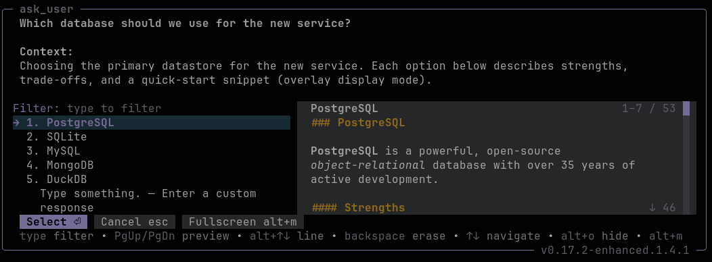
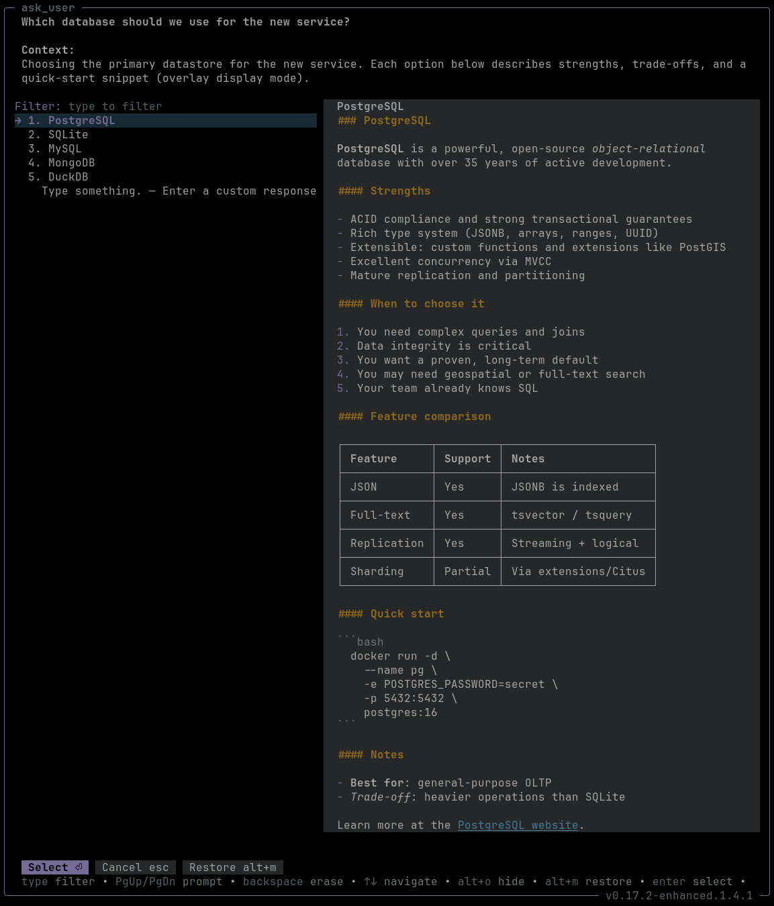
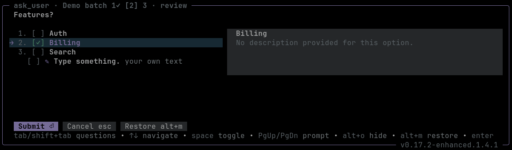

# pi-ask-user-enhanced: new features and how to use them

Version `0.17.2-enhanced.1.4.2`

[pi-ask-user-enhanced](https://github.com/droyed/pi-ask-user-enhanced) is an unofficial fork of [pi-ask-user](https://github.com/edlsh/pi-ask-user) 0.17.2 by Enzo Lucchesi. It keeps the same `ask_user` tool and adds the features below; everything else works as upstream. Install it with `pi install git:github.com/droyed/pi-ask-user-enhanced@enhanced-v1.4.2` after removing `npm:pi-ask-user`.



## At a glance

Most features work automatically. A few need a key, a setting, or a word in your prompt to the agent.

| Feature | What it does | How to get it | In pi-ask-user 0.17.2 |
| --- | --- | --- | --- |
| Adaptive display mode | Popup sized to the longest description (at most 65% of the terminal), with one steady height | Setting or prompt: `displayMode: "adaptive"` | `overlay` (8-row popup) and `inline` |
| Fullscreen display mode | The prompt fills the whole terminal | Setting or prompt: `displayMode: "fullscreen"` | — |
| Fullscreen key | Switches a popup to fullscreen and back | Key: Alt+M (change with `fullscreenToggleKey`) | — |
| Preview in multi-select | Shows the highlighted option's description beside a multi-select list | Automatic | Descriptions beside single-select options |
| Scrolling preview | Long descriptions scroll, with a header, line range, markers and a scrollbar | Automatic; keys PgUp/PgDn, Alt+↑/↓, Alt+Home/End | Description shown up to the panel's height |
| Clickable links | Links in descriptions open in your browser | Automatic, in terminals that support it | Links shown as text |
| Narrow layouts | A preview strip under the list, or an expanding option, in narrow terminals | Automatic | List without the preview |
| Look | Highlight bar, tinted preview, smooth scrollbar, a row of buttons | Automatic | Theme colours and key hints |
| Mouse | Click, double-click, wheel, scrollbar drag and buttons | Automatic in Pi's default fullscreen interface (Pi 1.0.2+) | Keyboard |
| Your own text as a checkbox | In multi-select, your typed text can be ticked, unticked, edited and removed like an option | Automatic, on the “Type something” row | Your text is sent in place of the ticked options |
| Combined answer | Sends the ticked options and your text together | Automatic | Options or text |
| Submitting a multi-select | Enter and Submit wait until something is ticked | Automatic | With nothing ticked, Enter sends the highlighted option |
| Numbered options | Options carry ids; answers include `selectedIds` | Prompt: give each option an `id` | — |
| Preselected options | The prompt opens with options already ticked or highlighted | Prompt: `preselectedIds` | — |
| Headless multi-select | A text-box flow for custom text, and a retry on invalid input | Automatic, on RPC and headless hosts | An invalid answer ends the question with an error |

## Try it in two minutes

Two prompts show most of the new features. Paste each into Pi.

### 1. A rich, scrollable preview

```
Use ask_user with displayMode "adaptive": ask "Which database should we use for the new service?" with 4 single-select options: PostgreSQL, SQLite, DuckDB, MongoDB. Give each a markdown description of 40-60 lines with a heading, a bullet list, a short table, a code block and a link to the project's website.
```

1. The highlighted option's description shows beside the list, formatted, with a header, a line range and a scrollbar.
2. Press ↓: the preview follows, and the popup keeps one height.
3. Press PgDn to page through the description, or scroll it with the mouse wheel.
4. Press Alt+M for fullscreen, and again to go back.
5. Click an option, then click **Select**.

### 2. Multi-select with your own text

```
Use ask_user with displayMode "adaptive", allowMultiple true: ask "Build your pizza" with options Cheese, Olives, Pepperoni, Mushrooms, Jalapeños, each with a one-line description. After I answer, show my order as a table: every ticked topping costs $1.50. Split any text I type into separate items: edible items cost $1.50, anything else costs $10.00 and is marked "non-food". Put instructions that aren't items as notes under the table. End with the total.
```

1. Press Enter with nothing ticked: nothing is sent, and the help line says “nothing ticked yet”.
2. Tick Cheese with Space, and Pepperoni by clicking its box.
3. On “Type something”, press Space, type `extra basil, a gift card, well done please`, and press Enter. The row comes back ticked.
4. Press Space to untick it (“○ not sent”), and again to tick it back.
5. Press Enter. The agent gets the ticked toppings and your text together, and prices the order.

## Details by feature

### Display modes and the fullscreen key

`displayMode` takes two new values beside upstream's `overlay` and `inline`:

- **`adaptive`:** a popup sized to fit the longest option description, never taller than 65% of the terminal. It keeps one height while you move between options.
- **`fullscreen`:** the prompt fills the whole terminal.

Set a default in `~/.pi/agent/ask-user.json` (`"displayMode": "adaptive"`) or with `PI_ASK_USER_DISPLAY_MODE`, or ask for it in a prompt: *“Use `ask_user` with displayMode ‘fullscreen’ …”*. A prompt's choice wins over the settings.

While a popup is open, **Alt+M** switches it to fullscreen and back. Change the key with `fullscreenToggleKey` (in a prompt or `ask-user.json`, or with `PI_ASK_USER_FULLSCREEN_TOGGLE_KEY`); `"off"` turns it off.



### The preview

The panel beside the list shows the highlighted option's description, now in multi-select too.

- A one-row header shows the title, plus a range such as `1–7 / 52` when the description is longer than the panel.
- `↑ n` / `↓ n` at the edges count hidden lines, and a scrollbar appears when the text overflows.
- **PgUp/PgDn** page through a long description; when it fits, they scroll the question instead. **Alt+↑/↓** move a line, **Alt+Home/End** jump to the start or end.
- Links in descriptions are clickable in terminals that support them, such as Ghostty and WezTerm. In Ghostty, hold Shift+Ctrl while clicking.

To use it, ask the agent to give options markdown descriptions.

### Narrow terminals

The layout follows the width inside the popup:

| Inside width | Window width in overlay mode | Layout |
| --- | --- | --- |
| 84 columns or more | about 96 or more | List on the left, preview on the right |
| 60–83 | about 70–95 | List, with the preview in a strip underneath |
| Under 60 | under about 70 | Only the highlighted option expands its description, in place |

On short terminals, long context collapses to one line so the options stay visible; Ctrl+E expands it. Long titles wrap in single-select lists and are cut off in multi-select lists and the preview header.

### Look

The highlighted option gets a full-width selection bar, the preview sits on a tinted panel, and the scrollbar moves in small steps. When there's room, a row of buttons appears above the key hints: **Select** or **Submit**, **Cancel**, and **Fullscreen**. Colours follow your Pi theme.

### Mouse

In Pi's default fullscreen interface (`tuiMode: "fullscreen"`), on Pi 1.0.2 or later:

- Click an option to highlight it; double-click to choose it or tick it.
- Click a checkbox to tick it without moving the highlight.
- Scroll the wheel over the list to move, or over the preview to scroll.
- Drag the scrollbar, or click above or below it to jump a page.
- Click the buttons, including on a batch's review page.

Every action still has a key. Pi 0.74 has no mouse input for extensions.

### Your own text in multi-select

In a multi-select question, the “Type something” row works like one more checkbox:

| On the row | What happens |
| --- | --- |
| Space, Enter, `e` or → (empty row) | Opens the editor, which shows what's already ticked |
| Enter in the editor | Saves the text and returns to the list, with the row ticked |
| Esc in the editor | Undoes that edit; text you leave with Esc is never sent |
| Space | Ticks or unticks saved text; unticked text stays, dimmed, marked “○ not sent” |
| `e` or → | Edits saved text; saving ticks it again |
| Enter | Submits the prompt |
| Backspace | Removes the text |

With the mouse: click the box to tick or untick, the text to edit, and “⌫ clear” to remove. The help line shows these keys while the row is highlighted.



The ticked options and your ticked text are sent together as a **`combined`** answer; your text alone is sent as a `freeform` answer. Single-select is unchanged.

### Submitting a multi-select

A multi-select submits only what's ticked. With nothing ticked, Enter and Submit do nothing: the button is dimmed and the help line says “nothing ticked yet”. To answer with nothing, press Esc. Preselected options count as ticked.

### Numbered options and preselection

Give every option a unique whole-number `id`, and answers include **`selectedIds`** next to the option titles. **`preselectedIds`** opens the prompt with those options ticked (multi-select) or highlighted (single-select, one id). Ask for it by name in a prompt, for example:

```
Use ask_user with allowMultiple true: ask "Which checks should run before deploy?" with options id 1 "Unit tests", id 2 "Integration tests", id 3 "Security scan", and preselectedIds [1, 3].
```

Once one option has an `id`, all need one. `preselectedIds: []` means nothing is preselected. In a batch, set it on each question. The review page and tool cards show option titles only, so they always match the question page; the agent's tool result keeps the ids (for example `5: Billing`).

### Without the interactive UI

On RPC and headless hosts, a multi-select question is one text box with numbered options. When custom text is allowed, the list ends with “✏️ Type something (add your own text)”, and a second box opens only if you pick it. An invalid answer asks again, quoting what you typed, instead of failing the tool call.

## Settings and keys reference

### New settings

A value in a prompt wins over the environment variable, which wins over `ask-user.json`. Upstream ignores these settings, so a shared `ask-user.json` is safe with both.

| Setting | Values | In a prompt | Environment variable | `~/.pi/agent/ask-user.json` | Default |
| --- | --- | --- | --- | --- | --- |
| Display mode | `overlay`, `inline`, `adaptive`, `fullscreen` | `displayMode` | `PI_ASK_USER_DISPLAY_MODE` | `displayMode` | `overlay` |
| Fullscreen key | any Pi key spec, or `off` | `fullscreenToggleKey` | `PI_ASK_USER_FULLSCREEN_TOGGLE_KEY` | `fullscreenToggleKey` | `alt+m` |
| Option ids | unique whole numbers | `id` on each option | — | — | none |
| Preselected options | a list of ids | `preselectedIds` | — | — | none |

In a prompt, name the setting exactly (for example *“set displayMode to fullscreen”*); agents can miss looser wording.

### New keys

| Key | What it does | Where |
| --- | --- | --- |
| Alt+M | Fullscreen and back | Any popup |
| PgUp / PgDn | Page through a long description | Preview, when it overflows |
| Alt+↑ / Alt+↓ | Scroll the description one line | Preview |
| Alt+Home / Alt+End | Jump to the start or end of the description | Preview |
| Space | Tick or untick your own text | “Type something” row (multi-select) |
| `e` or → | Edit your own text | “Type something” row (multi-select) |
| Backspace | Remove your own text | “Type something” row (multi-select) |
| Enter | Submit (only once something is ticked) | Multi-select |

Upstream's other keys (Esc, Tab, Ctrl+E, Ctrl+G, Alt+O and the rest) work as before.

### Known limitation

Text in some scripts can misalign: Pi measures text width with its own library, and terminals don't always agree. In Ghostty this affects Devanagari (Hindi); in WezTerm also Japanese, emoji and accented letters. Upstream behaves the same way.

More detail, including the changelog, is in [ENHANCED.md](ENHANCED.md).
